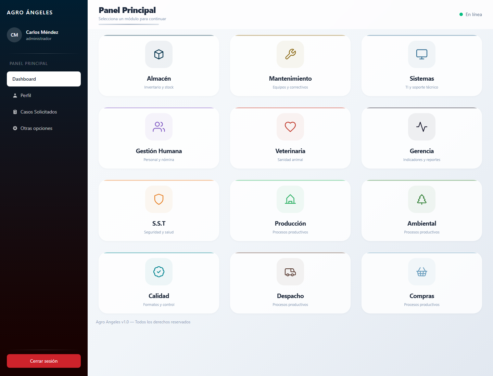
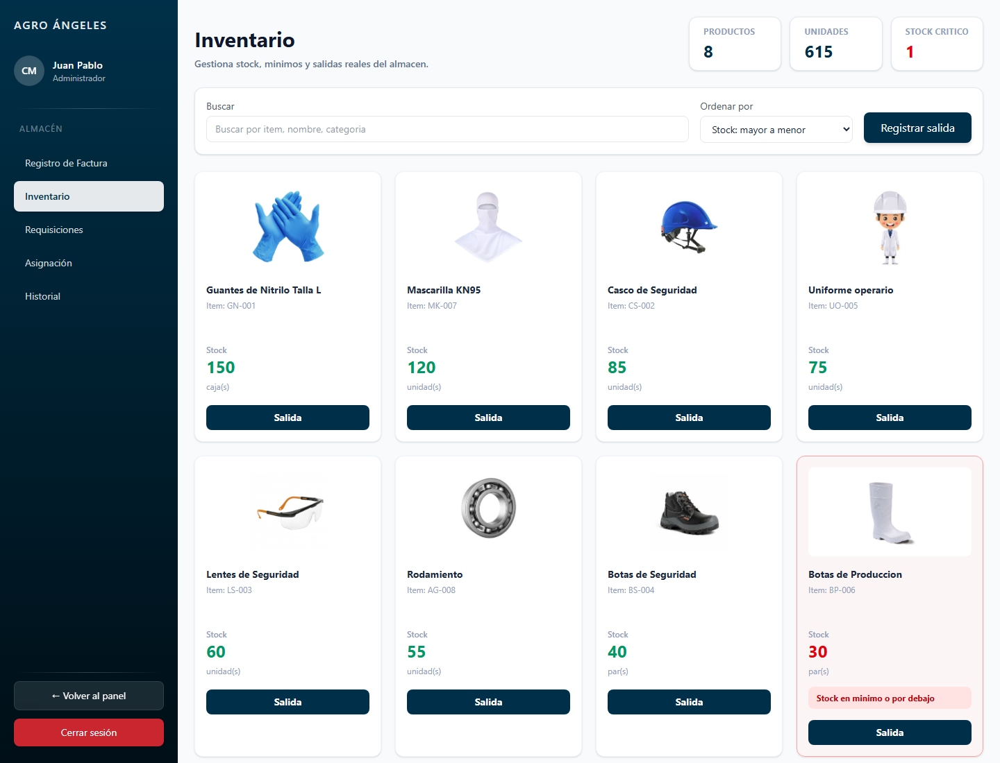
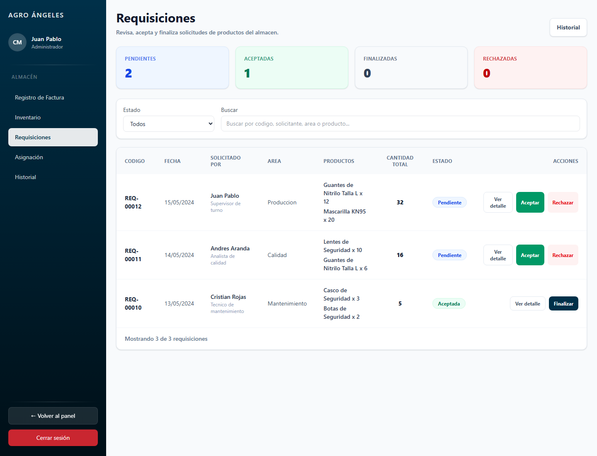
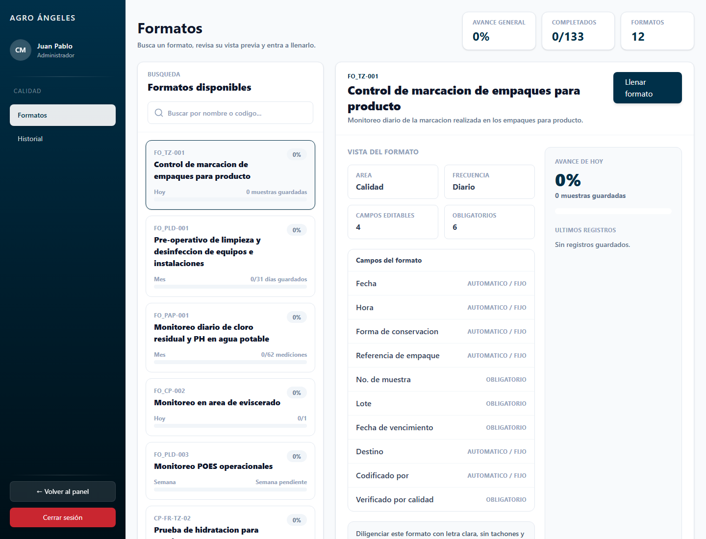
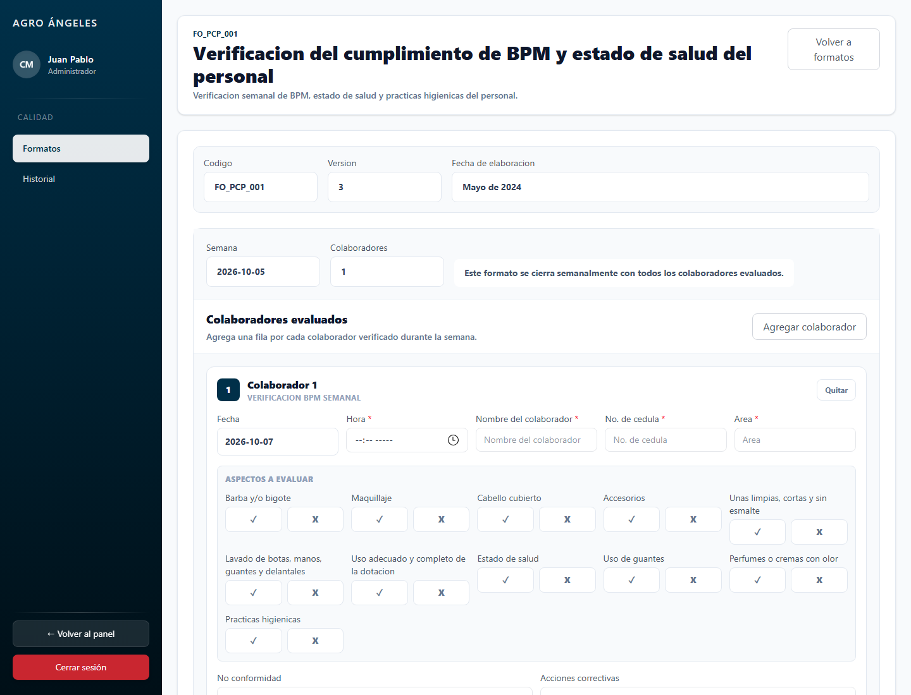
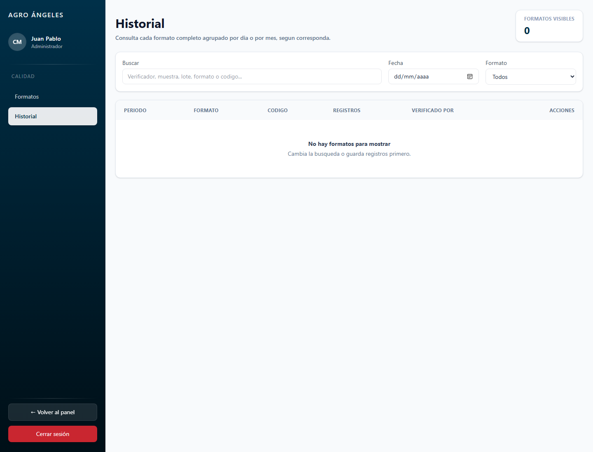

# Informe del Frontend Agro Angeles

Fecha del informe: 7 de octubre de 2026  
Proyecto: `inventario-frontend`  
Ubicacion del proyecto: `C:\Users\Usuario\OneDrive\Documentos\Frontend\inventario-frontend`

## 1. Resumen Ejecutivo

El frontend desarrollado corresponde a una plataforma interna para Agro Angeles orientada a centralizar procesos administrativos y operativos por modulos. La aplicacion funciona como una SPA construida en React con Vite, donde cada area de la empresa puede ingresar a su propio modulo desde un panel principal.

El objetivo general del proyecto es reemplazar controles manuales, formatos fisicos, archivos de Excel sueltos y procesos dispersos por pantallas digitales organizadas. El desarrollo ya incluye modulos para Almacen, Calidad, Gestion Humana, Compras y Mantenimiento, ademas de un dashboard principal que muestra todos los modulos disponibles para el usuario.

Actualmente el frontend trabaja principalmente con datos locales, usando `localStorage` en los modulos mas avanzados y estados internos de React en otros modulos. Esto permite probar el funcionamiento real de los flujos sin depender todavia de un backend. Para pasar a produccion se requiere conectar autenticacion, base de datos, APIs, almacenamiento de archivos y permisos por usuario.



## 2. Proposito del Proyecto

El proyecto se hizo para resolver varios problemas operativos:

- Evitar que cada area trabaje con archivos separados, papeles o controles manuales dificiles de consultar.
- Centralizar informacion de inventario, requisiciones, formatos de calidad, solicitudes y documentos.
- Reducir errores humanos mediante campos obligatorios, fechas automaticas, calculos de avance y validaciones.
- Facilitar busquedas, historiales, descargas y trazabilidad.
- Preparar una base frontend lista para conectarse posteriormente a un backend empresarial.

La idea no es solamente tener pantallas bonitas. En las areas mas trabajadas, especialmente Almacen y Calidad, ya hay funcionalidad real: se guardan datos, se actualizan existencias, se registran salidas, se agrupan formatos, se calculan porcentajes y se permite consultar historial.

## 3. Tecnologias Utilizadas

El frontend esta construido con:

| Tecnologia | Uso dentro del proyecto |
|---|---|
| React 19 | Construccion de componentes, pantallas, formularios, estados y flujos interactivos. |
| Vite | Servidor de desarrollo y empaquetado del frontend. |
| React Router DOM | Definicion de rutas, navegacion entre dashboard y modulos. |
| Tailwind CSS / clases utilitarias | Estilos visuales, grillas, espaciado, colores y responsividad. |
| CSS propio | Estilos compartidos del modulo de Almacen, especialmente formularios y botones. |
| localStorage | Persistencia local temporal para Almacen y Calidad. |

Scripts principales:

```bash
npm run dev
npm run build
npm run lint
npm run preview
```

## 4. Como Iniciar el Frontend

Para iniciar el proyecto desde una terminal:

```bash
cd C:\Users\Usuario\OneDrive\Documentos\Frontend\inventario-frontend
npm install
npm run dev -- --host 127.0.0.1
```

Luego se abre:

```text
http://127.0.0.1:5173/dashboard
```

Si aparece un error de Windows similar a `spawn EPERM`, normalmente no es un problema del codigo sino de permisos del entorno. En ese caso conviene volver a ejecutar el servidor desde una terminal con permisos suficientes o desde el entorno de Codex con permiso elevado.

Para generar una version de produccion:

```bash
npm run build
```

## 5. Estructura General del Proyecto

La estructura principal es:

```text
src/
  App.jsx
  config/
    Modules.jsx
  components/
    Layout/
    ui/
  modules/
    almacen/
    calidad/
    compras/
    dashboard/
    gestion-humana/
    mantenimiento/
```

Los archivos mas importantes son:

| Archivo | Funcion |
|---|---|
| `src/App.jsx` | Define las rutas principales de la aplicacion. |
| `src/config/Modules.jsx` | Centraliza los modulos, permisos simulados, rutas, colores e iconos. |
| `src/components/Layout/ModuleLayout.jsx` | Layout general usado para abrir un modulo con sidebar y contenido. |
| `src/modules/almacen/data/almacenStore.js` | Datos, carga, guardado y helpers del modulo de Almacen. |
| `src/modules/calidad/data/calidadStore.js` | Plantillas, validaciones, progreso y persistencia de formatos de Calidad. |
| `src/modules/calidad/pages/Documentos.jsx` | Pantalla de formatos disponibles y formularios digitales de Calidad. |
| `src/modules/calidad/pages/HistorialFormatos.jsx` | Historial, detalle y descarga de formatos de Calidad. |

## 6. Navegacion y Layout

La navegacion esta basada en `react-router-dom`. La aplicacion redirige la ruta inicial `/` hacia `/dashboard`.

Desde el dashboard se ingresa a cada modulo:

- `/app/almacen`
- `/app/calidad`
- `/app/gestion-humana`
- `/app/compras`
- `/app/mantenimiento`
- otros modulos definidos como Sistemas, Veterinaria, Gerencia, SST, Produccion, Ambiental y Despacho.

El archivo `Modules.jsx` contiene un usuario simulado llamado `MOCK_USER`, con rol `administrador` y permisos para ver todos los modulos. Cuando exista backend, este usuario debe ser reemplazado por la respuesta real del login.

Los modulos principales tienen sidebars propios. En Calidad se adapto el sidebar para mantener la misma linea visual usada en Almacen: fondo azul oscuro, usuario, navegacion interna, boton de volver al panel y boton de cerrar sesion.

## 7. Dashboard Principal

El dashboard es la puerta de entrada del sistema.

Funcionamiento:

- Lee los modulos definidos en `MODULES`.
- Filtra los modulos segun `MOCK_USER.modulos_permitidos`.
- Muestra tarjetas de acceso a cada area.
- Permite navegar al modulo seleccionado.

Por que se hizo:

El dashboard permite que todos los modulos vivan en una sola aplicacion, sin tener pantallas independientes o enlaces sueltos. Tambien deja preparada la estructura para que cada usuario vea solamente las areas que le corresponden.

Requiere para produccion:

- Login real.
- Roles por usuario.
- Permisos de modulos desde backend.
- Datos reales de sesion.

## 8. Modulo de Almacen

El modulo de Almacen es uno de los mas funcionales del proyecto. Tiene datos persistentes en `localStorage`, control de inventario, salidas, requisiciones e historial.

Rutas:

| Ruta | Pantalla |
|---|---|
| `/app/almacen/registro-factura` | Registro de factura. |
| `/app/almacen/inventario` | Inventario. |
| `/app/almacen/requisiciones` | Requisiciones. |
| `/app/almacen/asignacion` | Asignacion. |
| `/app/almacen/historial` | Historial de movimientos. |
| `/app/almacen/historial-requisiciones` | Historial de requisiciones. |

### 8.1 Persistencia de Almacen

Los datos se guardan con estas claves:

| Clave | Contenido |
|---|---|
| `agro_almacen_productos` | Productos, stock y stock minimo. |
| `agro_almacen_movimientos` | Entradas, salidas y solicitudes convertidas en movimiento. |
| `agro_almacen_requisiciones` | Requisiciones y sus estados. |

Esto permite que si el usuario cierra la pagina y vuelve a entrar, los cambios hechos en inventario y requisiciones se mantengan en ese navegador.

### 8.2 Inventario



La pantalla de Inventario permite:

- Ver productos en tarjetas.
- Buscar por nombre, item o categoria.
- Ordenar por mayor stock, menor stock, nombre o productos criticos.
- Ver metricas: cantidad de productos, unidades totales y stock critico.
- Abrir el detalle de un producto.
- Modificar el stock minimo dentro del detalle del producto.
- Resaltar en rojo los productos cuyo stock esta en el minimo o por debajo.
- Registrar salidas de uno o varios productos.

Por que se hizo:

Antes el control de inventario dependia de consultas manuales o listados poco dinamicos. Esta pantalla permite saber rapidamente que productos estan bajos y registrar salidas afectando el stock real del frontend.

Ejemplo de uso:

1. El usuario busca `Guantes`.
2. Abre el producto.
3. Ajusta el stock minimo si es necesario.
4. Presiona `Salida`.
5. Agrega uno o varios productos.
6. Ingresa cantidad, area, responsable, observacion y firma.
7. Guarda la salida.
8. El sistema descuenta el stock y crea un movimiento en historial.

Validaciones importantes:

- No se puede registrar una salida sin productos.
- Las cantidades deben ser enteras y mayores a cero.
- No se puede entregar mas cantidad que la disponible en stock.
- Se exige fecha, area, nombre de quien recibe y firma digital.

### 8.3 Registro de Salida con Firma

El formato de salida se hizo como un modal grande y funcional. Incluye:

- Fecha de entrega.
- Area destino.
- Varios productos en una misma salida.
- Cantidad por producto.
- Stock disponible por producto.
- Nombre de quien recibe.
- Observacion.
- Firma digital en canvas.

La firma puede hacerse con mouse, trackpad, pantalla tactil, tablet o lapiz. Se guarda como imagen en base64 dentro del movimiento.

### 8.4 Requisiciones



La pantalla de Requisiciones permite:

- Ver requisiciones pendientes, aceptadas, finalizadas y rechazadas.
- Buscar por codigo, solicitante, area o producto.
- Filtrar por estado.
- Abrir detalle de una requisicion.
- Aceptar requisiciones pendientes.
- Rechazar requisiciones pendientes.
- Finalizar requisiciones aceptadas.

El flujo principal es:

```text
Pendiente -> Aceptada -> Finalizada
Pendiente -> Rechazada
```

Al finalizar una requisicion:

- Se valida que todos los productos existan en inventario.
- Se valida que haya stock suficiente.
- Se descuenta el stock.
- Se crea una salida en movimientos.
- La requisicion cambia a `finalizada`.

Por que se hizo:

Este flujo evita que una solicitud quede como simple vista. La requisicion ya tiene consecuencia operativa: si se finaliza, afecta inventario y queda trazabilidad.

### 8.5 Historial de Almacen

El historial muestra movimientos de inventario. Permite:

- Filtrar por tipo.
- Buscar por producto, area, observacion o responsable.
- Exportar CSV.
- Ver entradas, salidas y solicitudes registradas.

Requiere para produccion:

- Base de datos central.
- Consecutivos reales.
- Usuarios autenticados.
- Firma asociada a usuario y no solo al navegador.
- Exportes oficiales en PDF o Excel.

## 9. Modulo de Calidad

Calidad es el modulo mas especializado. Su objetivo es digitalizar formatos que antes se llenaban en Excel o en papel.

Rutas:

| Ruta | Pantalla |
|---|---|
| `/app/calidad/formatos` | Formatos disponibles, vista previa y diligenciamiento. |
| `/app/calidad/historial` | Historial, detalle y descarga de formatos guardados. |

Persistencia:

| Clave | Contenido |
|---|---|
| `agro_calidad_formatos_registros` | Registros de todos los formatos digitales de Calidad. |

### 9.1 Pantalla de Formatos



La pantalla de Formatos permite:

- Buscar formatos por nombre o codigo.
- Ver todos los formatos disponibles.
- Ver porcentaje de avance por formato.
- Ver avance general del modulo.
- Seleccionar un formato.
- Ver una vista previa.
- Entrar a llenar el formato en pagina grande.

Por que se hizo:

El area de Calidad maneja muchos formatos y no todos tienen la misma frecuencia. Algunos son diarios, otros se consolidan mensualmente y otros semanalmente. Por eso se construyo un sistema de plantillas, no una pantalla fija por cada caso.

### 9.2 Logica de Plantillas

Cada formato se define en `calidadStore.js` dentro de `formatTemplates`. La plantilla indica:

- Codigo.
- Version.
- Nombre.
- Descripcion.
- Frecuencia.
- Periodicidad: diaria, semanal o mensual.
- Layout o tipo de formulario.
- Campos requeridos.
- Tablas dinamicas.
- Opciones de seleccion.
- Guias de no conformidades y acciones correctivas.

Gracias a esto el modulo puede tener formularios muy diferentes sin romper la estructura general.

### 9.3 Formatos Digitalizados

Formatos implementados hasta este informe:

| Codigo / ID | Nombre | Frecuencia | Almacenamiento | Layout |
|---|---|---|---|---|
| `FO_TZ-001` | Control de marcacion de empaques para producto | Diario | Diario | Tabla de muestras |
| `FO_PLD-001` | Pre-operativo de limpieza y desinfeccion de equipos e instalaciones | Diario mensual | Mensual | Checklist por dias 1 al 31 |
| `FO_PAP-001` | Monitoreo diario de cloro residual y PH en agua potable | Dos veces al dia | Mensual | Mediciones |
| `FO_CP-002` | Monitoreo en area de eviscerado | Diario segun viajes | Diario | Tabla dinamica de viajes |
| `FO_PLD-003` | Monitoreo POES operacionales | Diario con cierre semanal | Semanal | Controles por area y dia |
| `CP-FR-TZ-02` | Prueba de hidratacion para canales | Una vez al dia | Diario | 10 muestras |
| `FO.CP-003` | Monitoreo de control de temperatura canales PCC | Cada hora | Diario | Mediciones + grafica PCC |
| `FO_CT-004` | Verificacion de temperatura ambiente y producto en cuartos frios | Diario | Mensual | Controles por fecha |
| `FO_CP-006` | Monitoreo de producto despachado | Normalmente 4 despachos | Diario | Despachos dinamicos |
| `FO_PCP-009` | Verificacion cloro residual tanques de enfriamiento | Cada hora | Diario | Controles dinamicos |
| `FO_PCP-010` | Control PCC enfriamiento visceras | Segun muestreos | Diario | Secciones de visceras, patas y cabeza |
| `FO_PCP_001` | Verificacion del cumplimiento de BPM y estado de salud del personal | Semanal | Semanal | Colaboradores con firma |

### 9.4 Ejemplo: Formato BPM Semanal



Este formato fue creado a partir de la foto principal y del archivo Excel de apoyo.

Funcionamiento:

- Se maneja semanalmente.
- La fecha se coloca automaticamente.
- La hora es editable.
- Se pueden agregar todos los colaboradores necesarios.
- Nombre del colaborador, cedula y area son campos manuales.
- Los aspectos BPM se marcan con `✓` o `X`.
- Se registra no conformidad si aplica.
- Se escriben acciones correctivas.
- El colaborador firma en un panel digital.
- Se registra quien monitoreo o verifico.
- Se cierra la semana con coordinador o jefe de proceso.
- Se incluye auxiliar de calidad si aplica.

Aspectos evaluados:

- Barba y/o bigote.
- Maquillaje.
- Cabello cubierto.
- Accesorios.
- Unas limpias, cortas y sin esmalte.
- Lavado de botas, manos, guantes y delantales.
- Uso adecuado y completo de la dotacion.
- Estado de salud.
- Uso de guantes.
- Perfumes o cremas con olor.
- Practicas higienicas.

Por que se hizo:

Este formato necesitaba conservar la logica del papel, pero adaptada a uso digital. La firma era importante porque el colaborador debe firmar fisicamente en computador, laptop, tablet o con lapiz. Por eso se uso un canvas de firma, no un campo de texto.

### 9.5 Historial de Calidad



El historial permite:

- Buscar por formato, codigo, verificador, lote, muestra u otros campos.
- Filtrar por fecha.
- Filtrar por formato.
- Ver el detalle completo de un formato guardado.
- Descargar el formato como archivo compatible con Excel.
- Agrupar los datos segun la periodicidad real.

Agrupaciones:

| Tipo de formato | Agrupacion en historial |
|---|---|
| Diario | Un formato por dia. |
| Mensual | Un formato consolidado por mes. |
| Semanal | Un formato consolidado por semana. |
| Por muestras | Muestras guardadas dentro del periodo correspondiente. |
| Por viajes | Todos los viajes del dia en un mismo formato. |

Por que se hizo:

El historial no debe mostrar solo registros sueltos; debe mostrar el formato completo como lo entiende Calidad. Por ejemplo, si un formato se llena varias veces al dia, el historial lo une como un solo documento del dia. Si es mensual, se descarga el mes completo.

### 9.6 Progreso de Formatos

El modulo calcula porcentajes:

- Por formato individual.
- De forma global para todos los formatos.
- Segun la frecuencia configurada.

Ejemplos:

- Si un formato diario se debe llenar una vez, al guardarlo llega a 100%.
- Si un formato mensual se llena todos los dias del mes, el porcentaje depende de cuantos dias se han completado.
- Si un formato tiene dos mediciones diarias y se guarda una, el avance mensual refleja la cantidad real frente al total esperado.
- Si un formato semanal ya fue guardado, la semana queda al 100%.

Requiere para produccion:

- Confirmar todos los formatos oficiales definitivos.
- Definir responsables/verificadores reales.
- Definir codigos de no conformidad definitivos.
- Backend para guardar registros de forma centralizada.
- Exportes PDF oficiales con logo, encabezado, version y firma.
- Control de edicion despues de cierre.
- Auditoria de quien lleno, modifico o descargo cada formato.

## 10. Modulo de Gestion Humana

Gestion Humana tiene varias pantallas avanzadas visualmente y con logica local en memoria.

Rutas:

| Ruta | Pantalla |
|---|---|
| `/app/gestion-humana/ingresos` | Proceso de ingreso. |
| `/app/gestion-humana/perfil-usuario` | Perfil y documentos del colaborador. |
| `/app/gestion-humana/novedades` | Novedades de personal. |
| `/app/gestion-humana/bienestar` | Calendario y bienestar. |
| `/app/gestion-humana/informe` | Informe y exportacion CSV. |

### 10.1 Ingresos

Permite llenar datos personales del colaborador, calcular porcentaje de completitud, cargar documentos de afiliacion y visualizar inducciones.

Incluye:

- Datos personales.
- EPS, pension, cesantias y ARL.
- Contacto de emergencia.
- Porcentaje circular de avance.
- Afiliaciones con carga de archivo.
- Inducciones por area.
- Documento de induccion visual.

Estado actual:

Funciona como prototipo interactivo en el navegador, pero no persiste en backend ni en `localStorage`.

### 10.2 Perfil de Usuario

Permite:

- Buscar usuarios.
- Filtrar por estado.
- Abrir panel de detalle.
- Ver documentos personales, afiliaciones, inducciones y novedades.
- Calcular avance documental.
- Editar documentos dentro de un drawer.

### 10.3 Novedades

Permite registrar novedades por empleado:

- Permisos.
- Incapacidades.
- Vacaciones u otros tipos definidos.
- Adjuntar archivo.
- Ver historial por categoria.

### 10.4 Bienestar

Incluye calendario de eventos y metricas de actividades.

Permite:

- Crear eventos.
- Clasificarlos por tipo.
- Ver calendario mensual.
- Ver proximos eventos.
- Cambiar de mes.

### 10.5 Informe

Permite:

- Seleccionar rango de fechas.
- Generar registros.
- Calcular totales.
- Exportar CSV.

Requiere para produccion:

- Base de datos de empleados.
- Almacenamiento de documentos.
- Firma digital o aceptacion formal para inducciones.
- Flujo de aprobacion para novedades.
- Integracion con nomina si aplica.

## 11. Modulo de Compras

El modulo de Compras gestiona solicitudes de compra.

Rutas:

| Ruta | Pantalla |
|---|---|
| `/app/compras/solicitudes` | Solicitudes de compra. |
| `/app/compras/historial` | Historial de compras. |

### 11.1 Solicitudes de Compra

Permite:

- Ver solicitudes.
- Buscar por codigo, solicitante, area, producto o item.
- Aceptar compra.
- Rechazar solicitud.
- Ver detalle en panel lateral.
- Mostrar producto con imagen.

Estado actual:

Funciona con datos iniciales en memoria. Los cambios duran mientras la pagina esta abierta.

### 11.2 Historial de Compras

Permite:

- Consultar compras ya registradas.
- Filtrar y revisar detalles.
- Ver estados y datos asociados.

Requiere para produccion:

- Solicitudes reales desde areas.
- Relacion con proveedores.
- Ordenes de compra.
- Autorizaciones por rol.
- Integracion con factura y almacen.

## 12. Modulo de Mantenimiento

El modulo de Mantenimiento contiene flujo de solicitudes, historial y administracion de maquinaria.

Rutas:

| Ruta | Pantalla |
|---|---|
| `/app/mantenimiento/solicitudes-mantenimiento` | Solicitudes de mantenimiento. |
| `/app/mantenimiento/historial-mantenimiento` | Historial de mantenimiento. |
| `/app/mantenimiento/maquinarias` | Maquinarias y preventivos. |

### 12.1 Solicitudes de Mantenimiento

Permite:

- Ver solicitudes asignadas.
- Filtrar por usuario, prioridad, area y cercania a vencimiento.
- Ordenar por tiempo restante, prioridad o area.
- Ver notificaciones de solicitudes cercanas a vencer.
- Abrir detalle.
- Gestionar solicitud.
- Asignar tecnico.
- Marcar como realizada con fecha e imagenes.
- Solicitar tiempo extra con justificacion.

Estado actual:

Los datos funcionan en memoria local de React. Es funcional para demostrar el flujo, pero no persiste al recargar.

### 12.2 Historial de Mantenimiento

Permite:

- Consultar registros historicos.
- Filtrar por estado, prioridad y usuario.
- Ver detalle de una solicitud.
- Revisar tiempos, evaluaciones y datos del mantenimiento.

### 12.3 Maquinarias

Permite:

- Ver listado amplio de maquinarias.
- Buscar por nombre o codigo.
- Filtrar por preventivos del mes.
- Crear maquinaria.
- Editar maquinaria.
- Eliminar maquinaria.
- Ver detalle de maquinaria.
- Programar mantenimiento preventivo.
- Consultar preventivos y correctivos.

Requiere para produccion:

- Maestro real de maquinarias.
- Historial tecnico por equipo.
- Evidencias fotograficas almacenadas en servidor.
- Estados oficiales de mantenimiento.
- Flujo de aprobacion para tiempos extra.
- Asignacion real de tecnicos.

## 13. Modulos Definidos pero Pendientes de Desarrollo Completo

En `Modules.jsx` existen otros modulos ya preparados para aparecer en el dashboard:

- Sistemas.
- Veterinaria.
- Gerencia.
- S.S.T.
- Produccion.
- Ambiental.
- Despacho.

Estos modulos tienen tarjeta, ruta base, color, icono y permiso simulado. Algunos pueden abrir una pantalla placeholder si no tienen paginas propias todavia.

Por que se dejaron definidos:

Esto permite que la arquitectura ya contemple todas las areas de la empresa. Cuando se empiece un modulo nuevo, no se arranca desde cero: se agrega sidebar, rutas y pantallas usando el mismo patron.

## 14. Estado Funcional por Modulo

| Modulo | Estado actual | Persistencia | Observacion |
|---|---|---|---|
| Dashboard | Funcional | No requiere | Usa permisos simulados. |
| Almacen | Muy funcional | `localStorage` | Inventario, salidas, requisiciones e historial trabajan con datos persistentes locales. |
| Calidad | Muy funcional | `localStorage` | Sistema de formatos digitales, progreso, historial y descargas. |
| Gestion Humana | Prototipo funcional | Estado en memoria | Pantallas avanzadas, falta persistencia real. |
| Compras | Prototipo funcional | Estado en memoria | Acepta/rechaza solicitudes durante la sesion. |
| Mantenimiento | Prototipo funcional avanzado | Estado en memoria | Gestiona solicitudes y maquinarias durante la sesion. |
| Otros modulos | Base preparada | No aplica | Definidos en dashboard, pendientes de paginas reales. |

## 15. Decisiones de Diseno y Por Que se Tomaron

### 15.1 Un dashboard central

Se eligio un dashboard porque el sistema tiene muchas areas. Un usuario no deberia buscar enlaces manualmente; debe entrar a una pantalla principal y seleccionar su modulo.

### 15.2 Un `Modules.jsx` centralizado

Se hizo para que colores, rutas, iconos, permisos y nombres de modulos esten en un solo sitio. Esto facilita agregar nuevas areas.

### 15.3 Sidebars por modulo

Se usaron sidebars para que cada area tenga navegacion interna. En Almacen y Calidad se estandarizo el estilo visual para que la experiencia sea consistente.

### 15.4 localStorage como etapa intermedia

Se uso `localStorage` para probar funcionalidad sin backend. Es suficiente para validar el flujo con usuarios, pero no reemplaza una base de datos real.

### 15.5 Calidad basado en plantillas

Calidad tiene muchos formatos distintos. Hacer una pagina rigida por cada formato seria dificil de mantener. Por eso se creo una estructura de plantillas, layouts y validaciones reutilizables.

### 15.6 Firmas digitales con canvas

Se usaron firmas dibujables porque varios formatos requieren firma real del colaborador o receptor. Un campo de texto no seria suficiente.

## 16. Ejemplos de Flujo

### Ejemplo 1: Salida de Almacen

1. El usuario entra a `Almacen > Inventario`.
2. Presiona `Registrar salida`.
3. Selecciona uno o varios productos.
4. Ingresa cantidades.
5. Selecciona area.
6. Escribe quien recibe.
7. Firma en el panel digital.
8. Guarda.
9. El stock se descuenta automaticamente.
10. El movimiento aparece en historial.

### Ejemplo 2: Requisicion de Almacen

1. El usuario entra a `Almacen > Requisiciones`.
2. Abre el detalle de la solicitud.
3. Revisa productos y stock disponible.
4. Acepta la requisicion.
5. Luego aparece la opcion de finalizar.
6. Al finalizar, el sistema descuenta inventario y registra la salida.

### Ejemplo 3: Formato Diario de Calidad

1. El usuario entra a `Calidad > Formatos`.
2. Busca el formato por nombre o codigo.
3. Abre la vista previa.
4. Presiona `Llenar formato`.
5. Completa los campos obligatorios.
6. Guarda la muestra, medicion o formato.
7. El avance del formato se actualiza.
8. En historial se puede ver y descargar.

### Ejemplo 4: Formato Semanal de Calidad

1. El usuario abre el formato semanal.
2. Agrega los registros necesarios durante la semana.
3. Cada colaborador firma digitalmente.
4. Al guardar, la semana queda consolidada.
5. En historial aparece como un solo formato semanal.

## 17. Datos y Almacenamiento Actual

Hoy el sistema no usa backend. Los datos se manejan asi:

| Area | Fuente actual |
|---|---|
| Modulos y permisos | `MOCK_USER` en `Modules.jsx`. |
| Productos de Almacen | Datos iniciales + `localStorage`. |
| Movimientos de Almacen | Datos iniciales + `localStorage`. |
| Requisiciones de Almacen | Datos iniciales + `localStorage`. |
| Formatos de Calidad | Plantillas en codigo + registros en `localStorage`. |
| Gestion Humana | Arrays y estados internos. |
| Compras | Arrays y estados internos. |
| Mantenimiento | Arrays y estados internos. |

Esto sirve para desarrollo y validacion, pero para trabajo real multiusuario se requiere backend.

## 18. Requisitos Generales para Produccion

Para que el proyecto pueda usarse en produccion por varias personas, se necesita:

1. Backend con API REST o similar.
2. Base de datos central.
3. Login real.
4. Roles y permisos por usuario.
5. Manejo de sesiones.
6. Almacenamiento de imagenes, documentos y firmas.
7. Auditoria de cambios.
8. Exportes oficiales PDF/Excel.
9. Consecutivos controlados por servidor.
10. Control de estados y aprobaciones.
11. Copias de seguridad.
12. Validaciones de negocio en backend, no solo frontend.

## 19. Requisitos Especificos por Modulo

### Almacen

- Catalogo real de productos.
- Entradas por factura conectadas al inventario.
- Salidas oficiales con consecutivo.
- Requisiciones provenientes de otras areas.
- Control de stock minimo por producto.
- Reportes de movimientos.
- Usuarios responsables y firma.

### Calidad

- Todos los formatos oficiales digitalizados.
- Versionamiento de formatos.
- Fechas automaticas controladas por servidor.
- Cierres diarios, semanales y mensuales.
- Firmas de responsables.
- Historial inalterable despues de cierre.
- Descarga oficial en PDF/Excel.
- Listas oficiales de verificadores.

### Gestion Humana

- Base de datos de colaboradores.
- Adjuntos de documentos.
- Estados de induccion.
- Historial de novedades.
- Exportacion de informes.
- Flujo de aprobaciones.

### Compras

- Solicitudes desde areas.
- Proveedores.
- Ordenes de compra.
- Estados de aprobacion.
- Relacion con factura y almacen.

### Mantenimiento

- Maestro real de maquinaria.
- Solicitudes de mantenimiento por usuarios.
- Tecnicos asignados.
- Evidencias.
- Preventivos programados.
- Correctivos registrados.
- Historial por equipo.

## 20. Riesgos Actuales

| Riesgo | Explicacion | Solucion recomendada |
|---|---|---|
| Datos solo en navegador | Si se limpia el navegador, se pierden datos locales. | Conectar backend y base de datos. |
| No hay autenticacion real | El usuario actual es simulado. | Implementar login y permisos. |
| Varios modulos no persisten | Gestion Humana, Compras y Mantenimiento usan estado en memoria. | Crear stores persistentes o backend. |
| Exportes no son oficiales aun | Calidad descarga HTML compatible con Excel. | Crear generacion PDF/Excel formal. |
| Firmas en base64 local | La firma vive dentro del navegador. | Guardar archivos en servidor. |
| Fechas dependen del cliente | La fecha sale del computador del usuario. | Usar hora del servidor. |

## 21. Recomendaciones de Continuidad

Orden sugerido para continuar:

1. Terminar todos los formatos reales del modulo de Calidad.
2. Conectar Calidad a backend porque sera el modulo con mas datos historicos.
3. Completar Registro de Factura para que incremente inventario.
4. Unificar historial de requisiciones con las requisiciones reales.
5. Persistir Gestion Humana, Compras y Mantenimiento.
6. Implementar login y permisos.
7. Crear exportes oficiales.
8. Preparar pruebas de usuario por area.

## 22. Conclusiones

El frontend ya tiene una base solida para una plataforma modular interna. La arquitectura permite agregar areas nuevas sin romper lo existente. Almacen y Calidad ya tienen funcionalidad real con persistencia local, validaciones y flujos completos. Gestion Humana, Compras y Mantenimiento tienen pantallas y flujos utiles, pero todavia requieren persistencia real para considerarse productivos.

El avance mas importante esta en Calidad: se logro convertir formatos fisicos y Excel en formularios digitales con reglas diferentes por frecuencia, guardado por periodo, historial, busqueda, detalle y descarga. Esto deja preparado el camino para que el area deje de depender de formatos impresos y pueda manejar trazabilidad digital.

El siguiente salto importante del proyecto es conectar backend, usuarios reales y base de datos. Con eso, el frontend pasaria de ser un prototipo funcional avanzado a una herramienta operativa empresarial.
